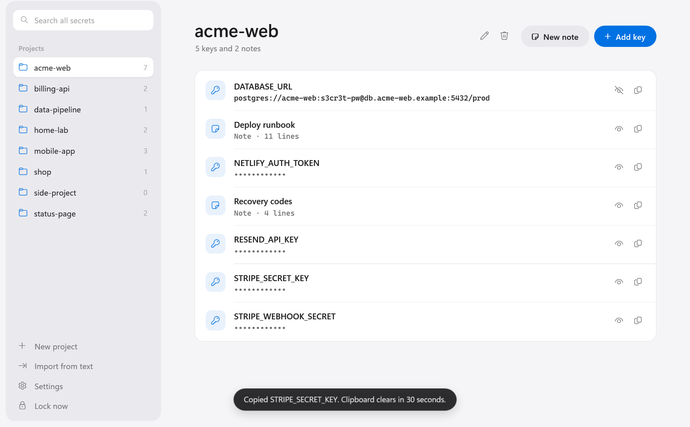
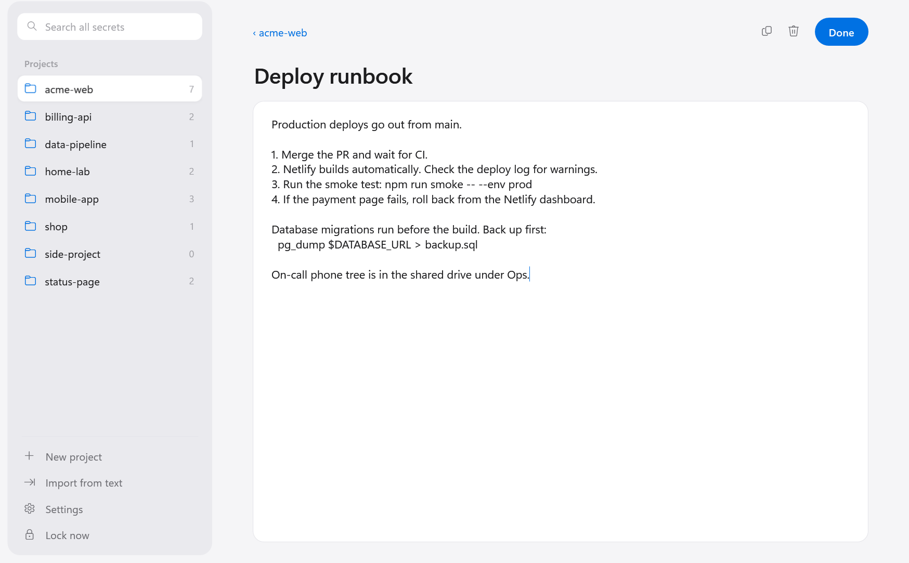
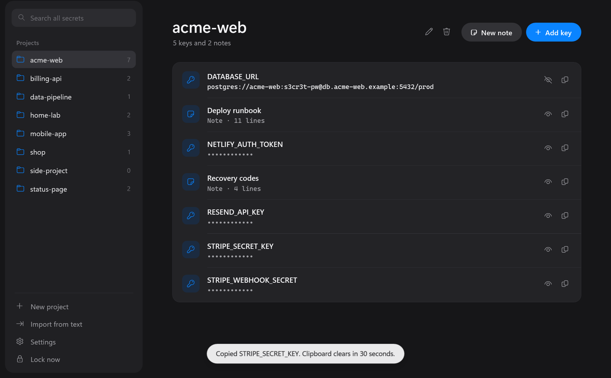
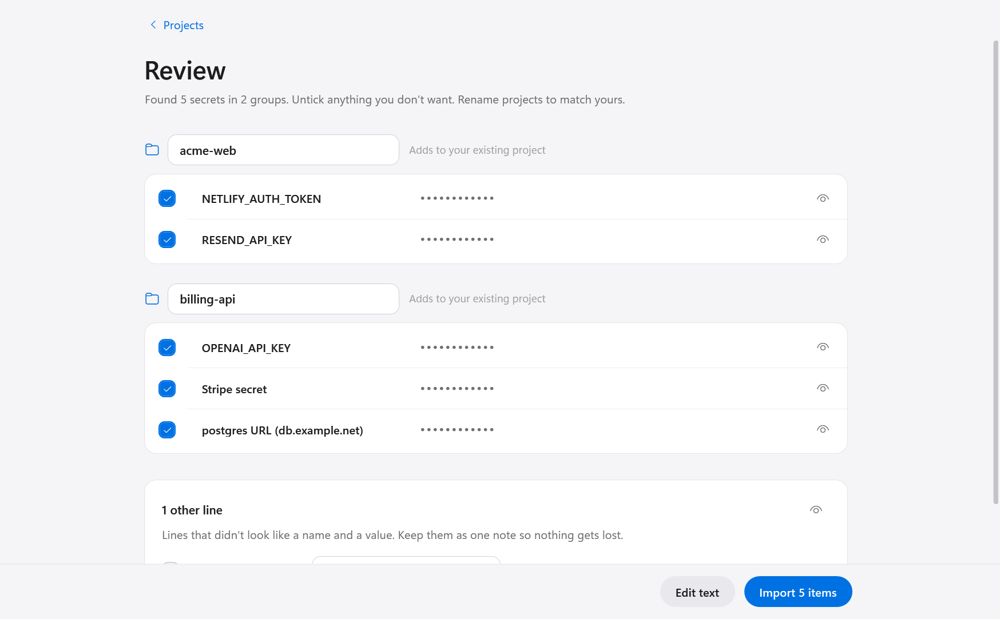

# Lockbox

A small Windows app for the API keys, passwords and notes a developer piles up across projects. It keeps them encrypted on your PC. There is no account, no sync service and no network code.



I built it to replace a folder of Notepad files. Password managers are designed around website logins and browser autofill. What I wanted was a list of projects, each with its keys, that opens with Windows Hello and copies a value in one click.

## What it does

- Groups secrets by project. A secret is either a key with a name and value, or a note.
- Notes open in a full-size editor for runbooks, server details, recovery codes and anything else that isn't a single value. The editor saves a second after you stop typing, and again when you close it or Lockbox locks.
- Hides every value until you press the eye button.
- Copies a value without it landing in Windows clipboard history or cloud clipboard, and clears the clipboard after 30 seconds.
- Searches across all projects by secret name or project name. Ctrl+F jumps to search.
- Imports messy notes. Paste text or open a file, and Lockbox suggests names, values and projects. Nothing is saved until you review the list and press Import.
- Unlocks with Windows Hello day to day. Every 14 days it asks for the passphrase instead, so you don't forget it.
- Locks after 5 minutes without input, when you lock Windows, and before the PC sleeps.
- Writes an encrypted copy to your Dropbox folder on every save, plus one dated copy per day for the last 10 days.
- Follows the Windows light or dark setting.

| Note editor | Dark mode |
|---|---|
|  |  |



## Install

You need Windows 10 or 11 and the [.NET 10 SDK](https://dotnet.microsoft.com/download/dotnet/10.0). Then run this in Windows PowerShell from the repo folder:

```powershell
.\install.ps1
```

The script builds a release copy, puts `Lockbox.exe` in `%LOCALAPPDATA%\Programs\Lockbox`, and adds Lockbox to the Start menu. Run it again after pulling changes. It never touches your vault.

On first launch, Lockbox asks for a passphrase of at least 16 characters. Five or more random words is the better choice. Write it down somewhere offline. Nobody can recover it.

## Keyboard shortcuts

| Keys | Action |
|---|---|
| Ctrl+F | Search all secrets |
| Ctrl+N | Add a key to the current project |
| Ctrl+Shift+N | Write a new note in the current project |
| Ctrl+L | Lock now |
| Esc | Close the open dialog or note, or clear the search |
| Click a note | Open it in the editor |
| Double-click a key | Edit that key |

## Backups and moving to a new PC

Lockbox reads the Dropbox app's own settings file to find your Dropbox folder, then writes backups to `<Dropbox>\Lockbox`. You can pick a different folder in Settings. The backup copies are the same encrypted file as the vault, so Dropbox only ever stores ciphertext.

To restore, install Lockbox on the new PC, choose **Restore from a backup** on the first screen, pick a `.lockbox` file and unlock it with your passphrase. Windows Hello does not carry over between PCs, so turn it on again in Settings.

## Files

| Path | Contents |
|---|---|
| `%LOCALAPPDATA%\Lockbox\vault.lockbox` | The encrypted vault |
| `%LOCALAPPDATA%\Lockbox\settings.json` | Backup folder and timestamps. Nothing secret. |
| `<Dropbox>\Lockbox\vault.lockbox` | Copy written on every save |
| `<Dropbox>\Lockbox\history\vault-YYYY-MM-DD.lockbox` | One copy per day, newest 10 kept |

## How it protects your data

One random 256-bit key encrypts the vault with AES-256-GCM. That key is stored twice in the file. One copy is locked by your passphrase through Argon2id with 256 MiB of memory. The other is locked by your Windows Hello key and then by Windows DPAPI for your account, so it only opens for you, on this PC, after a face, fingerprint or PIN check. Backups can only be opened with the passphrase.

[SECURITY.md](SECURITY.md) has the full design, what it does and doesn't protect against, and how to report a problem.

## Windows Hello status

Windows Hello unlock uses the default decryption key that Windows creates for each Hello user. On some PCs Windows can't reach that key and returns error `0x80090011` or `0xD0000225`. When this happens Lockbox refuses to turn Hello on and you keep unlocking with the passphrase. Lockbox only saves the Hello slot after one real unlock through the Windows Hello prompt succeeds.

## Building and testing

```powershell
dotnet test
```

The unit tests cover the encryption, the file format, backups, the Dropbox lookup and the import parser.

Debug builds of the app add three modes. Each uses a throwaway vault in `%TEMP%`, never your real one.

| Command | What it does |
|---|---|
| `Lockbox.exe --selftest report.txt` | Drives every screen's logic end to end, typing into the real passphrase boxes. The exit code is the number of failed checks. |
| `Lockbox.exe --snapshot folder` | Renders every screen to PNG in light and dark mode with demo data. |
| `Lockbox.exe --hello-probe report.txt` | Runs the Windows Hello encrypt and decrypt path on this PC. Shows real Hello prompts. |

## Project layout

| Folder | Contents |
|---|---|
| `src/Lockbox.Core` | Encryption, vault file format, backups, import parser. No UI code. |
| `src/Lockbox.App` | The WPF app, Windows Hello, clipboard and theme handling |
| `tests/Lockbox.Tests` | xUnit tests for Lockbox.Core |

## Limits worth knowing

- Nobody outside this project has audited the code. It uses the encryption built into .NET and Windows plus the [Konscious Argon2](https://github.com/kmaragon/Konscious.Security.Cryptography) package, and writes none of its own cryptography.
- It runs on Windows only.
- Revealed values stay in the app's memory until it exits, because .NET can't reliably wipe strings.

## License

MIT. See [LICENSE](LICENSE).
